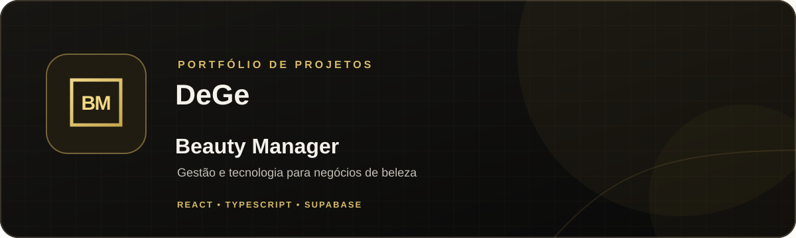

  

## Olá, eu sou DeGe

Estou construindo o **Barber Manager**, um sistema de gestão para barbearias, salões e negócios de prótese capilar.

### Projeto em destaque

**[Barber Manager](https://github.com/DeGe7/Barber-Manager)** reúne ferramentas para organizar:

- Atendimentos e agenda
- Clientes, equipe e permissões por cargo
- Produtos e estoque
- Planos, assinantes e mensalidades
- Financeiro e relatórios

### Stack do projeto

`React` · `TypeScript` · `Vite` · `Supabase` · `PostgreSQL` · `Playwright`

  <a href="https://github.com/DeGe7/Barber-Manager">Conheça o Barber Manager</a>
  &nbsp;·&nbsp;
  <a href="https://github.com/DeGe7">Veja meus repositórios</a>

